<p align="center">
  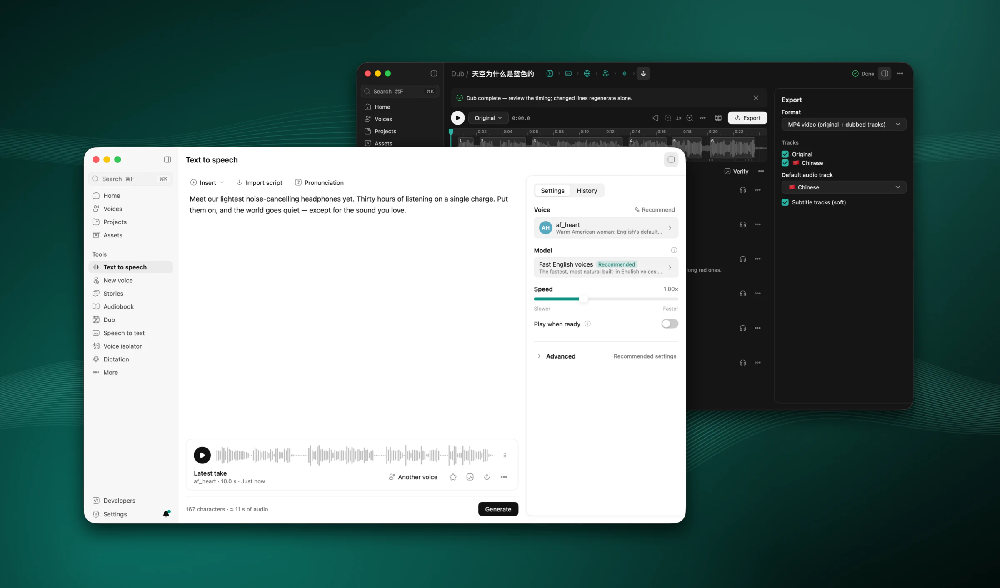
</p>

<h1 align="center">AudioSmith</h1>

<p align="center">
  <b>A voice studio that runs on your Mac.</b><br>
  Speech, voices, stories, audiobooks, dubbing, transcription, voice isolation and dictation, on Apple silicon.
</p>

<p align="center">
  <a href="https://actnow.dev/download/audiosmith"></a>
  
  
  <a href="LICENSE"></a>
  <a href="https://awesomemygo.dev/apps/audiosmith"></a>
</p>

<p align="center"><a href="https://actnow.dev/audiosmith">Website</a> · <a href="https://actnow.dev/download/audiosmith">Download</a> · <a href="https://actnow.dev/audiosmith/changelog">Changelog</a></p>

<p align="center"><b>English</b> · <a href="README.zh-CN.md">简体中文</a></p>

AudioSmith turns text into speech, clones and designs voices, gives a story a cast, reads a book into an M4B, dubs a video into another language, transcribes a recording with who said what, separates voices from music and noise, and types what you say into any app. You start from one box on Home, and AI agents can drive all of it over MCP. Every model runs on your Mac's GPU with [MLX](https://github.com/ml-explore/mlx): no account, no cloud service, no Python. It runs on your Mac, and once its models are downloaded it works offline.

[Features](#features) · [Install](#install) · [Models](#models) · [Privacy](#privacy) · [Build from source](#build-from-source) · [Licence](#licence-and-credits)

> **The current version, 0.5.0-beta.1, is a beta.** Releases are signed with a Developer ID, notarized by Apple and update themselves. Expect rough edges; see [Known limits](#known-limits) and [the changelog](https://actnow.dev/audiosmith/changelog).

## Features

### Start from Home

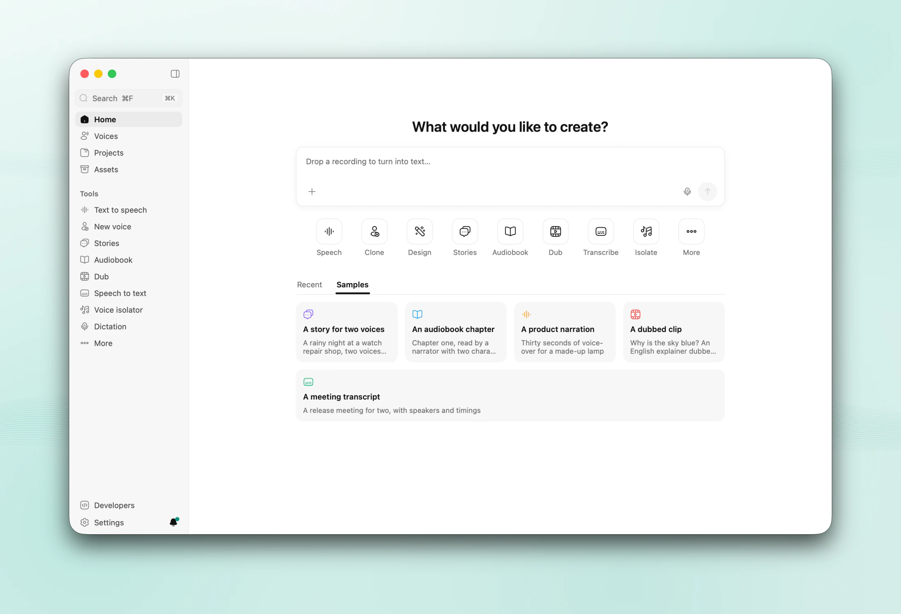

- **One box to start from.** Type, paste a link or drop a file and press Enter: text opens in Text to speech as the script, a video or a link starts a dub, a recording is transcribed, a text file or an ebook becomes an audiobook.
- **Places and tools.** The sidebar lists the places — Home, Voices, Projects, Assets — then the tools: Text to speech, New voice, Stories, Audiobook, Dub, Speech to text, Voice isolator and Dictation, with Workflows, Batch dubbing and Calls under ··· More. Each tool starts its work at the top of its page and lists what it made below; a result goes on to the next tool in one click.
- **Five samples** — a story for two voices, an audiobook chapter, a product narration, a short dubbed video and a meeting transcript — open ready to play, as projects of your own you can edit or delete.
- **⌘K searches everything:** pages, actions, voices, projects, samples and takes by their script.

### Text to speech

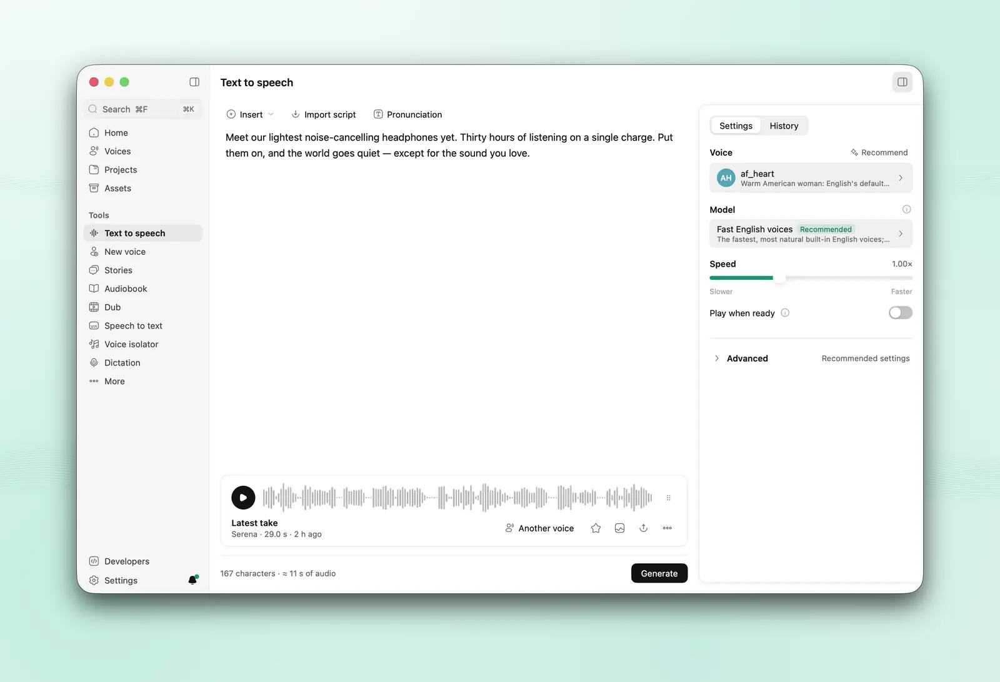

- **Write or import** a script (TXT, MD, DOCX, EPUB, SRT, VTT), or start from an example. Markup adds pauses (`[pause 400ms]`), pace (`[slow]`, `[fast]`), emphasis, spelling and one-off pronunciations (`[[word|say]]`).
- **Pick a model by what it is for:** Standard voices, Fast clone, High-fidelity clone, Voice design, Fast English voices, English clone or Multilingual all-rounder. The technical name is one click away.
- **Few controls:** the voice, the model and the speed in the Settings panel. Everything else is under Advanced, filled with settings measured for each model. The History panel keeps the page's takes: export, reuse their settings, try another voice, or save one as a project.
- **Long scripts** render in chunks and play while they render. Text you did not change comes from a cache.
- **Export audio:** WAV or M4A, and MP3, FLAC or Opus with ffmpeg. Even out the loudness to −16, −18 or −23 LUFS, trim the silence, add tags, save the script and subtitles beside it.

### Voices

| Discover | Mine |
|---|---|
| 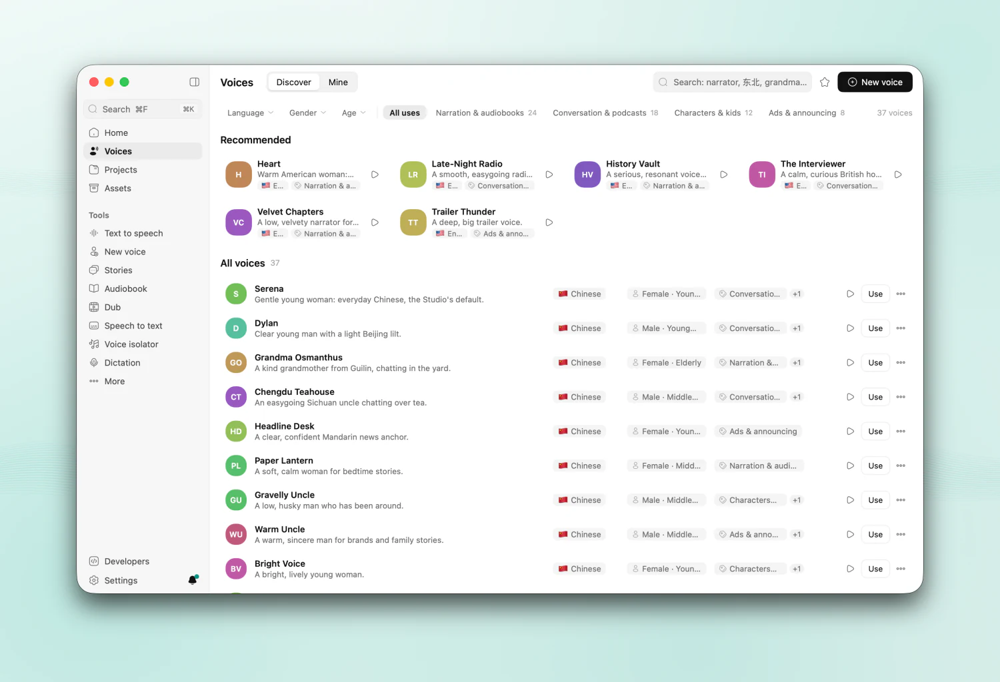 | 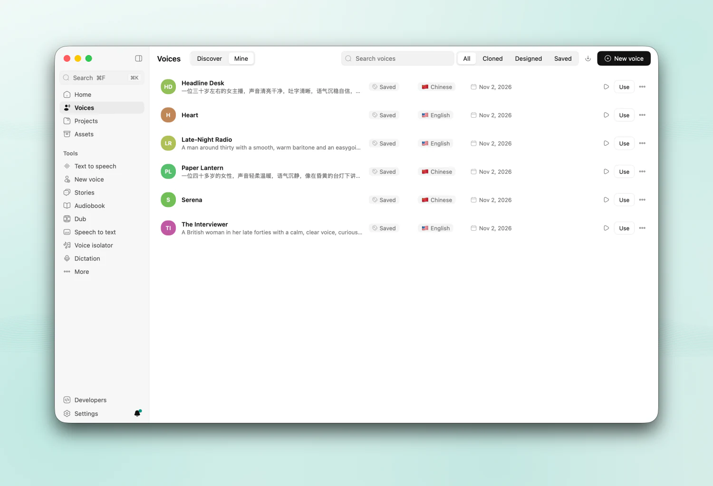 |

- **Discover** 37 chosen voices, mostly Chinese and English: designed voices whose reference ships with the app, ready to speak at once, and the best built-in speakers. Filter by language, gender, age and use; ▶ plays one in its row, and its details offer Try a line, Use in Text to speech, Use as a story character, Narrate an audiobook and Save to My voices.
- **Mine** lists your voices (cloned, designed, saved); rename, duplicate, export or delete them, with Undo.

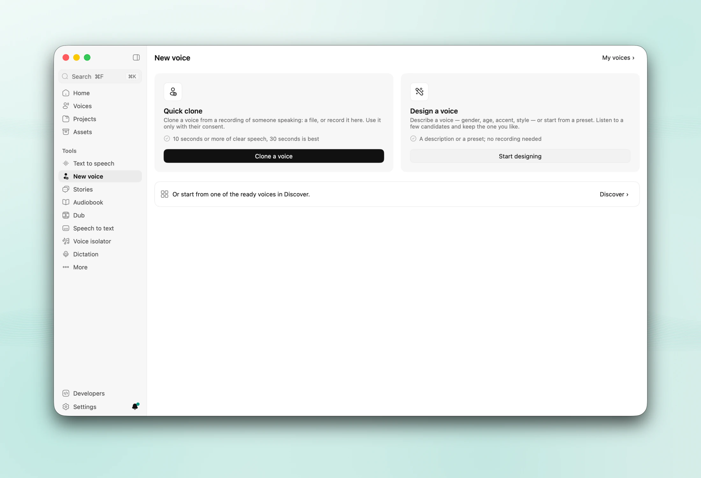

- **New voice → Quick clone:** add a recording, or any audio or video file, and a guided page checks it, names it and saves it. AudioSmith picks the best stretch and transcribes it; a recorded consent statement marks a voice as your own.
- **Checked references:** every reference is rated (good, fine, needs work) with a tip or two, and cleaned: noise removed only when there is some, silence trimmed, loudness evened out. The original is kept.
- **New voice → Design a voice:** describe it in English or Chinese ("a warm narrator in her thirties, calm and clear"), or start from a preset, and pick one of three candidates.
- **Hear before you pick:** every voice list (Text to speech, Stories, Audiobook, Dub) has a ▶ on each voice: built-in speakers play a short bundled sample, even before their model is downloaded; your own voices play their sample.
- **Portable voices:** a model's built-in speaker or a designed voice can be turned into a clone that every cloning model can speak with. It sounds close to the original, not the same, and says so.
- Voices are `.asvoice` files you can share. VoiceStudio's `.ovsvoice` files import too.

### Stories

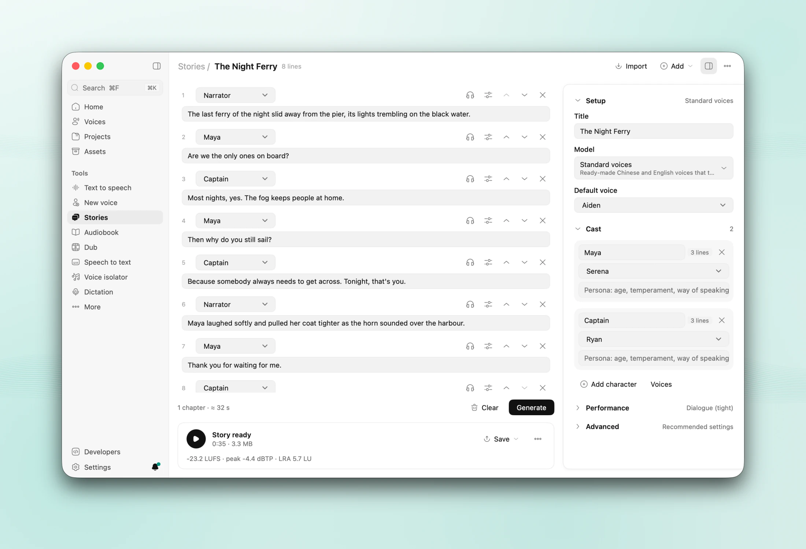

- **Start from the composer:** paste a script, or turn on 「Help me write」 and describe a story in a sentence; the writing assistant (on this Mac) drafts a short scene for two or three voices, then it is cast and opened.
- **Write `Name: line`** and AudioSmith casts the characters. Stage directions such as `MOM (softly):` become the line's direction instead of being read out.
- **Dialogue that flows:** the gaps follow the conversation (Dialogue, Reading or Relaxed). A character's consecutive lines are said in one go, and each voice is brought to one loudness.
- **AI director:** the writing assistant (Qwen3 4B, on this Mac) reads the whole story and gives each line one of 13 emotions with a strength, kept coherent across the scene; you can change any of them. Models that take instructions hear them; the others read the lines as written, and the page says so.
- **Whole dialogue:** a dialogue model speaks the characters' lines a scene at a time, so each line answers the one before it. *Dialogue · Light* (SoulX-Podcast) needs 16 GB of memory, *Dialogue · One take* (MOSS-TTSD) 24 GB. Narration stays on the story's model.
- Export a WAV, an M4B, or one stem per character.

### Audiobook

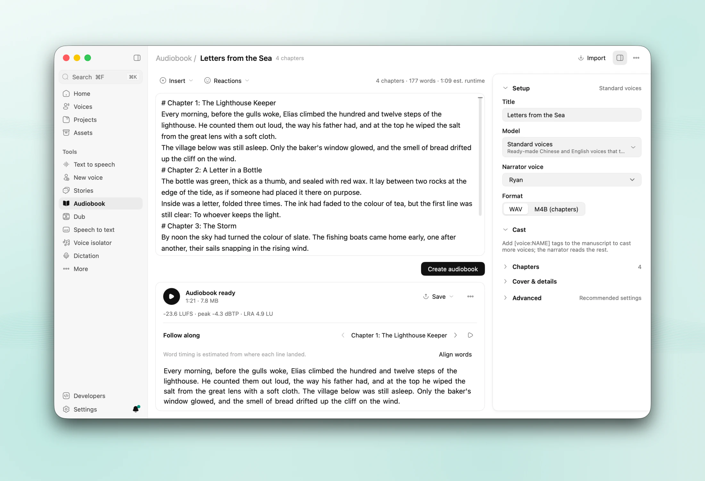

- **Paste or import** an EPUB, TXT, Markdown or DOCX book and pick the narrator. Chapters come from its headings.
- **Dialogue passages:** mark a scene with `[dialogue]` … `[/dialogue]` (`[对话]` in Chinese) and one `Name: line` per turn, and a dialogue model speaks it with the characters answering each other. Without the model the passage is read line by line.
- **Loudness** per chapter for ACX (Audible) or podcasts. A read-along player follows the text.
- **Export** an M4B with chapters, cover and tags, a cue sheet, or one file per chapter.
- **Resume** after quitting. After an edit, only the changed lines are rendered again.

### Dub

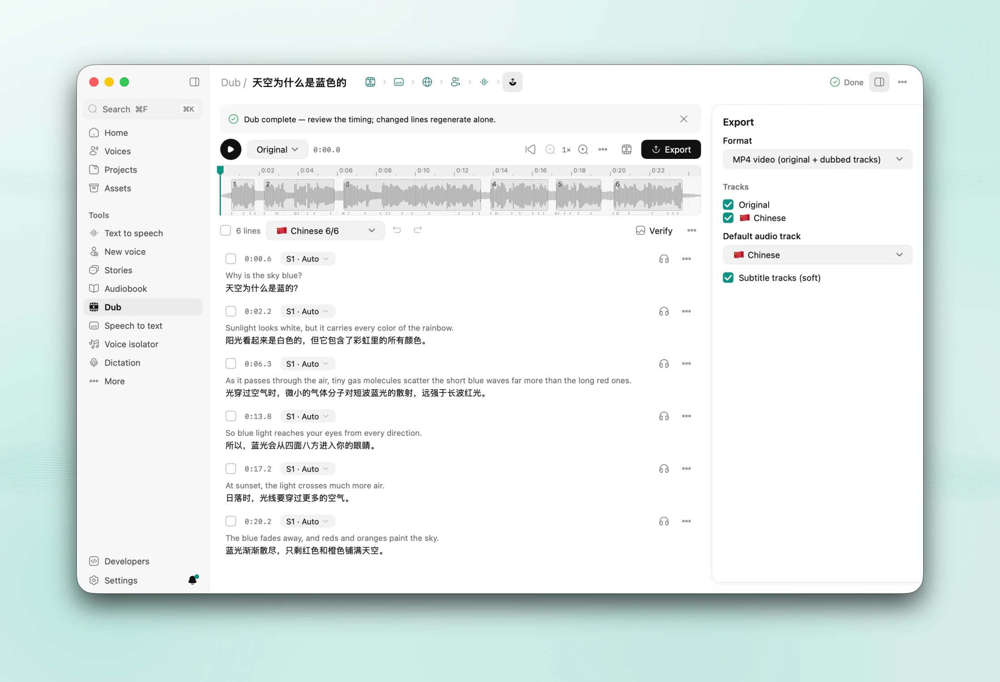

- **Drop in a video or audio file,** or paste a link (yt-dlp, which you turn on), and press Dub. Before anything downloads, the page shows the cover, the site, the title and the length, then the download's real progress. New dubs are made in Chinese; when the video is already Chinese they switch to English. Add more languages as you like.
- **The steps** — transcribe, translate, voices, generate, export — sit in the editor's header and show what is done, running or failed:
  1. Separate the voices from the background (HTDemucs), transcribe and tell the speakers apart (Transcription with speakers, or Qwen3-ASR with Sortformer).
  2. Translate with the local writing assistant, Ollama, a cloud model, DeepL, Google or Microsoft. A glossary keeps names right.
  3. Speak each line in its speaker's cloned voice, fitted to the original timing, also from another language (a Japanese speaker speaking Chinese). Such lines are heard again: one in the wrong language or with the wrong words is made again, or marked Listen.
- **Conversations recorded together:** for dubs into Chinese or English with two speakers or more, *Dialogue · Light* records each conversation as a whole, so answers sound like answers, then fits every line to its time. On by default for new dubs; needs 16 GB of memory.
- **Edit** lines on a timeline (click to seek, pinch or ⌘ with the wheel to zoom, swipe to pan), compare A/B, preview the video, and re-dub only what changed. A 2-hour video with 2,000 lines stays quick.
- **Export** an MP4 with one audio track per language and soft subtitles, or M4A, WAV, SRT, VTT, ASS and stems. Batch dubbing does a whole folder, and can watch one.

### Speech to text and dictation

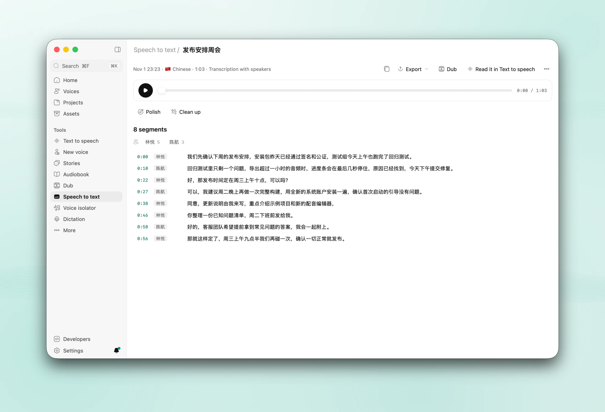

- **Transcribe** recordings and videos — drop, upload, paste a link or record — with word timings, Fast or Accurate. Qwen3-ASR handles Chinese, English and 28 more languages; Whisper covers the rest and translates speech into English.
- **Transcription with speakers** says who says what (S1, S2…) in one pass; click a speaker to name it. Copy, TXT, SRT, VTT and JSON exports carry the names. A transcript goes on to Dub or to Text to speech in one click.
- **Dictation anywhere:** press ⌘⇧Space in any app, speak, and the text is typed where your cursor is, about 0.2–0.3 s after you stop. Your clipboard is kept. A menu bar icon, a small pill and sounds you can choose show when it listens.

### Voice isolator

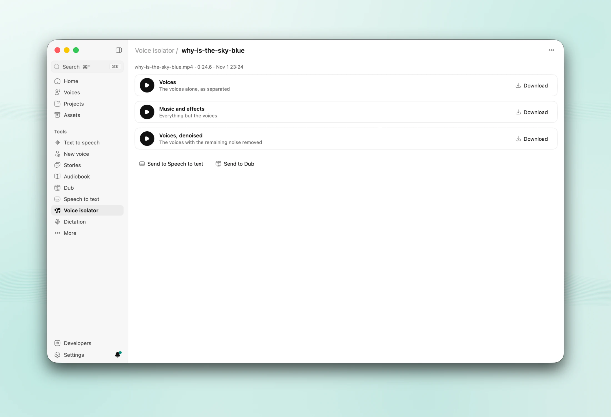

- **Drop a song, a video or a noisy recording** and get the voices alone, the music and effects, and the voices denoised (HTDemucs, DeepFilterNet), on this Mac.
- Each track plays, saves, and goes on to Speech to text or Dub.

### Projects and Assets

| Projects | Assets |
|---|---|
| 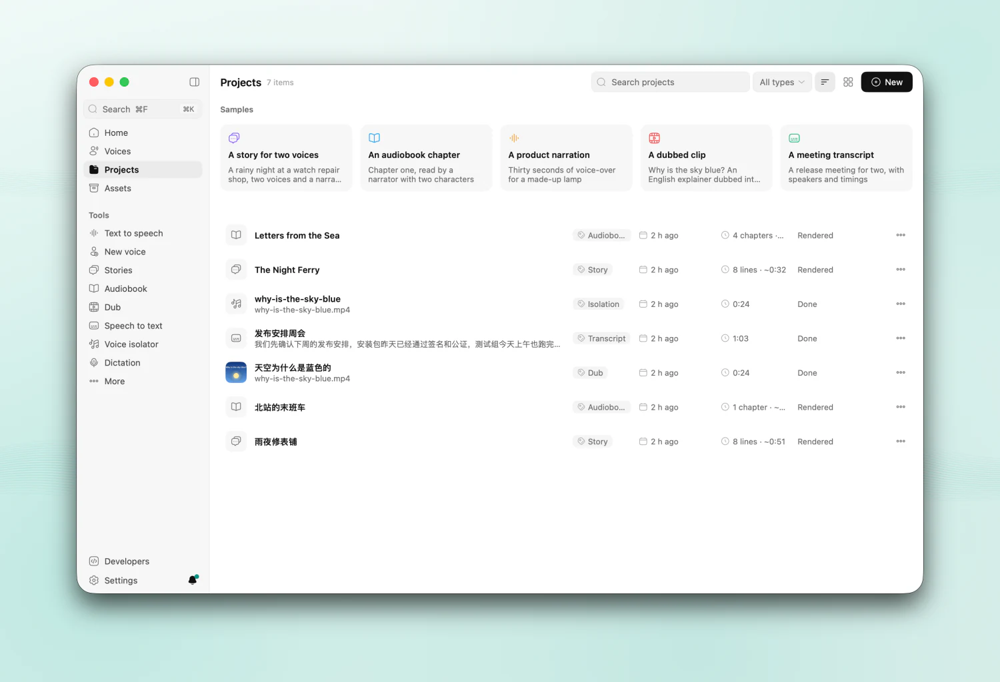 | 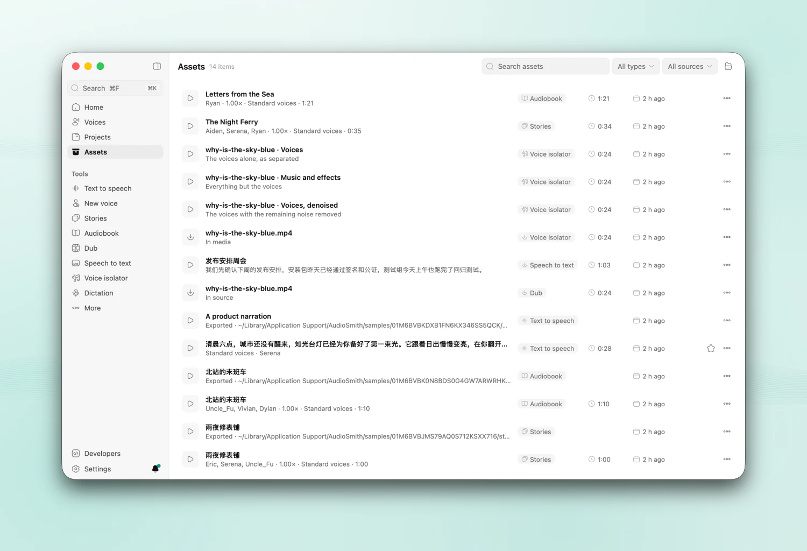 |

- **Projects** lists stories, audiobooks, dubs, transcripts and voice isolations, newest first; search their titles and scripts, filter by type, show a table or cards.
- **Assets** gathers every output and every file you brought in — takes, renders, exports, isolated tracks, the recordings and videos you used. Each plays in its row, opens in its tool, and sends on to Speech to text, Dub, Voice isolator or Text to speech.
- **Workflows** chain steps on a canvas (sources, speak, transcribe, translate, convert, even out, condition, export), start from a template and run over up to 50 inputs; **Batch dubbing** queues dubs and watches a folder. Both continue after a restart.

### For agents and scripts

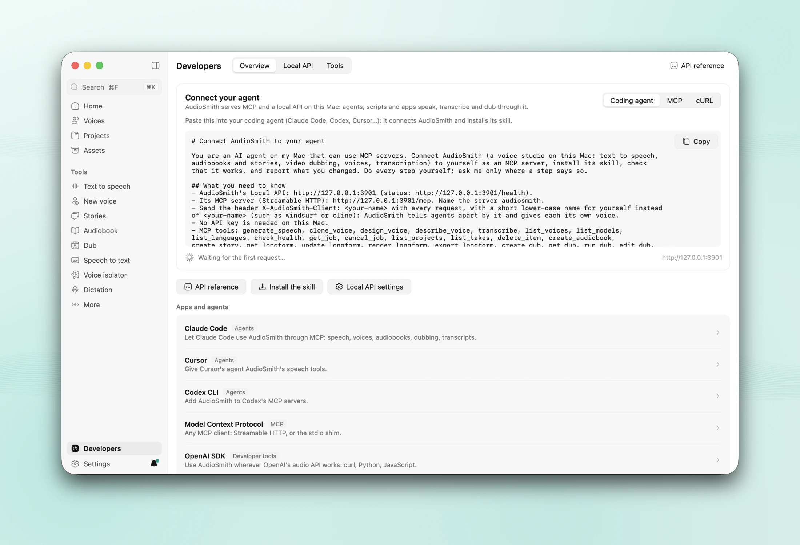

- **Developers → Connect your agent:** choose Coding agent, MCP or cURL and copy the snippet — a prompt your coding agent follows to connect AudioSmith and install its skill, the MCP server's configuration, or a first request — then watch "Waiting for the first request…" turn into the time of the last one. Setups for Claude Code, Codex, Cursor, n8n and others are listed under it.
- **MCP server** over HTTP (`/mcp`) and stdio (`AudioSmith --mcp-stdio`), with 57 tools: agents can do what the app does, except dictation, phone calls, the microphone, accepting licences and changing settings. Tested with ChatGPT (Codex) and WorkBuddy.
- **Agents ask before they delete or download:** the agent says what goes or how big the download is and waits for your yes. Cloning needs consent and works only from this Mac (or with the API key).
- **OpenAI-compatible API** on `http://127.0.0.1:3901/v1`: speech, transcriptions, translations, models and voices. Point any OpenAI SDK at it. **AudioSmith's own API** (`/api`) drives every page; jobs report progress over SSE, and `/ws/tts` streams speech.

```sh
curl http://127.0.0.1:3901/v1/audio/speech \
  -H 'Content-Type: application/json' \
  -d '{"model": "tts-1", "voice": "alloy", "input": "Build finished. All tests passed."}' \
  -o speech.wav
```

The full reference is [docs/local-api.md](docs/local-api.md), and `/docs` in the running app.

### And more

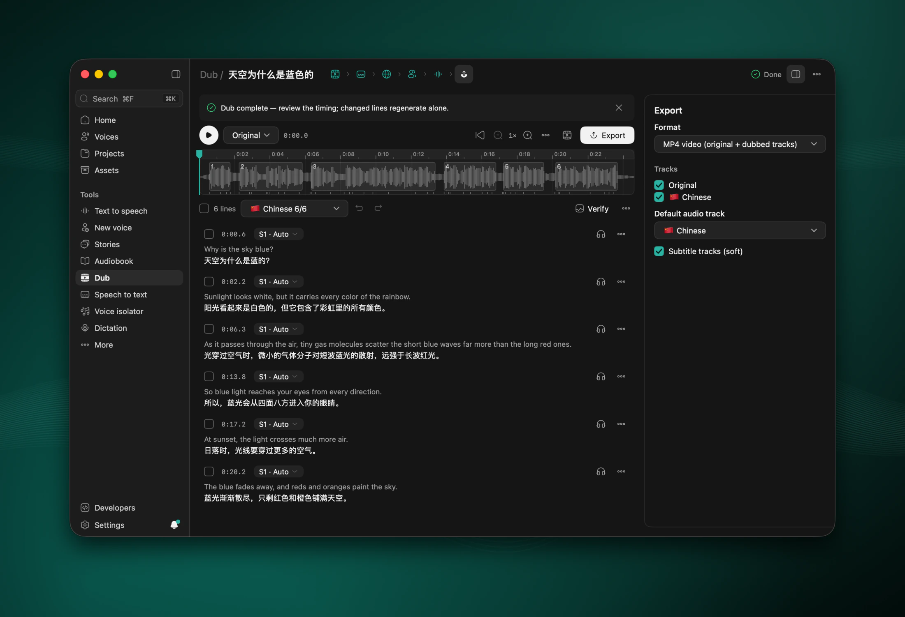

- **Tools** (Developers → Tools): compare voices A/B, speak a recording again in another voice, fit text to a duration, probe a file, check a watermark.
- **Invisible watermark:** generated audio carries an AudioSeal mark, on by default (Settings → Privacy), and Tools can detect it.
- **Calls:** an AI phone agent on your own Twilio account. It always says it is an AI, and uses only designed or consented voices. Off until you set it up.
- **The app:** each page has its own header with its tools; ⌘1–8 open Home, Text to speech, Voices, Projects, Dub, Speech to text, Stories and Audiobook, ⌘[ and ⌘] go back and forward. The bell beside Settings lists tasks and notifications; one job queue resumes after a restart. Light and dark themes, English and 简体中文.
- **Memory:** models you have not used for 30 minutes are unloaded (Settings → Models & network → Memory) and load again when needed.

## Install

**Requirements**
- macOS 15 or later, on Apple silicon (M1 or later).
- Memory: 8 GB runs the Fast pack; 16 GB is recommended, and needed for *Dialogue · Light*; 24 GB runs the Quality pack (high-fidelity cloning, voice design, dubbing and the writing assistant) and *Dialogue · One take*.
- Disk: 1.3–17 GB for models, depending on the pack; the dialogue models add 2.4 GB and 10.9 GB.

**Steps**
1. Download the DMG from [actnow.dev/download/audiosmith](https://actnow.dev/download/audiosmith), AudioSmith's page on our website. AudioSmith is free; the download needs a free account. Rather not sign up? [Build it from source](#build-from-source). The current version is a beta; [the changelog](https://actnow.dev/audiosmith/changelog) lists every version.
2. Drag **AudioSmith** to Applications and open it. Releases are signed and notarized, so Gatekeeper lets them open; macOS only asks once to confirm an app from the internet.
3. The setup wizard checks your Mac (macOS, chip, memory, disk, network), suggests a model pack, and asks about privacy and dictation. You can skip the pack and download models later in Settings → Models & network.

| Pack | For | Download |
|---|---|---|
| **Fast** | built-in voices and dictation; any Mac | 1.3 GB in English, 2.8 GB in Chinese |
| **Balanced** | + cloning, word timings, noise removal; 16 GB | 4.3 / 5.8 GB |
| **Quality** | + high-fidelity cloning, voice design, dubbing, speakers, writing assistant; 24 GB | 13.4 / 14.9 GB |
| **Max** | + Multilingual all-rounder (non-commercial) and Whisper; 48 GB | 15.5 / 17.0 GB |

**Updates.** Once a day AudioSmith checks actnow.dev for a new version (no account needed). A new one shows as "Update available" at the foot of the sidebar, with its notes; it installs when you say so. Updates are signed and checked before they install, and usually download only what changed. **AudioSmith → Check for Updates…** checks at once; **Settings → About → Software updates** has the other choices.

**Beta updates.** Settings → About → Software updates → **Receive beta updates**. It is on in a beta (such as 0.5.0-beta.1) and off in a release until you choose. Turning it off never goes back to an older version: a beta stays until a newer release is out.

**Downloads** come from the official sites or their mirrors, whichever is faster, through the system proxy: models from huggingface.co or hf-mirror.com, ffmpeg and yt-dlp from github.com or mirror.actnow.dev (ActNow's mirror), each checked before use. In mainland China, pick **Mirrors only** under **Settings → Models & network → Download from** if downloads stall.

**Models** are kept in `~/Library/Application Support/ActNow/models`, shared with the other ActNow apps, and left out of Time Machine (Settings → Advanced turns backups back on).

**Permissions** are asked only when a feature needs them: the **Microphone** for recording a voice, dictation and live transcription, and **Accessibility** for dictation to type into other apps.

## Models

AudioSmith names models for what they do. Their technical names, sizes and licences are in each model's details under Settings → Models & network.

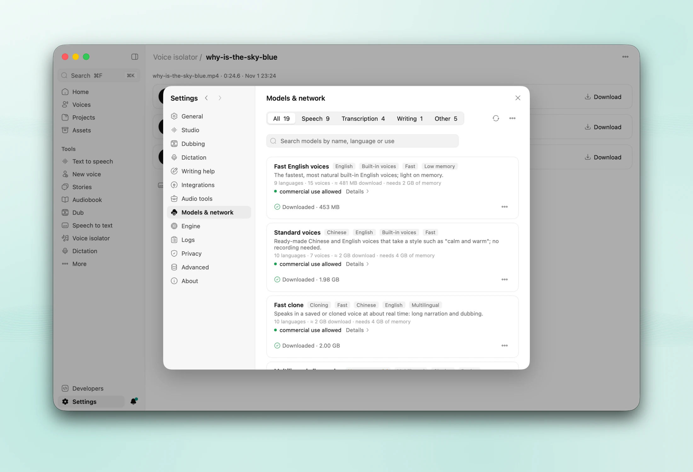

| In the app | Model | What it does | Licence |
|---|---|---|---|
| **Standard voices** | Qwen3-TTS 0.6B CustomVoice | built-in Chinese and English speakers, with directions | Apache-2.0 |
| **Fast clone** | Qwen3-TTS 0.6B Base | quick voice cloning | Apache-2.0 |
| **High-fidelity clone** | Qwen3-TTS 1.7B Base | the most faithful cloning | Apache-2.0 |
| **Voice design** | Qwen3-TTS 1.7B VoiceDesign | voices from a description | Apache-2.0 |
| **Fast English voices** | Kokoro 82M | natural English voices; light | Apache-2.0 |
| **English clone** | Chatterbox Turbo | fast English cloning | MIT |
| **Multilingual all-rounder** | OmniVoice | 600+ languages, cloning, design, exact durations | **CC BY-NC 4.0: non-commercial**; asks you to accept it first |
| **Chinese & English transcription** | Qwen3-ASR 0.6B | transcription and dictation, 30 languages | Apache-2.0 |
| **Multilingual transcription** | Whisper large-v3 turbo | other languages; speech into English | MIT |
| **Transcription with speakers** | MOSS-Transcribe-Diarize 0.9B | who says what, in one pass | Apache-2.0 |
| **Dialogue · Light** | SoulX-Podcast 1.7B | conversations recorded together, up to 4 speakers; 2.4 GB, 16 GB memory | Apache-2.0 |
| **Dialogue · One take** | MOSS-TTSD v1.0 | a scene as one recording, up to 5 speakers; 10.9 GB, 24 GB memory | Apache-2.0 |
| **Writing assistant** | Qwen3 4B Instruct 2507 | translation, clean-up, the AI director | Apache-2.0 |
| Word timing · Speech detection · Noise removal | Qwen3-ForcedAligner 0.6B · Silero VAD · DeepFilterNet 3 | | Apache-2.0 · MIT · MIT/Apache-2.0 |
| Fast voice separation · Speaker turns | HTDemucs · Sortformer (fallback, ≤ 4 speakers) | | MIT · NVIDIA Open Model License |
| Invisible watermark | AudioSeal | | MIT |

Measured on a MacBook Air M4 with 24 GB:

| What | Result |
|---|---|
| Dictation (Qwen3-ASR) | 0.2–0.3 s after you stop speaking |
| High-fidelity clone | about real time: 940 Chinese characters → 3.5 min of audio in about 3¼ min |
| Standard voices | about 1.7× real time |
| Transcription with speakers | a 10-minute recording in about 4 minutes |
| Dialogue · Light / One take | about 0.7× / 0.8× real time |
| Writing assistant | 36–40 tokens/s |

## Privacy

- **Speech is made and recognised on your Mac.** The engine never connects to the network; it loads the models the app downloaded.
- **AudioSmith connects only for:** model downloads (Hugging Face or its mirror), ffmpeg and yt-dlp when you download them, videos (and their covers) from links you paste, a cloud writing or translation provider only if you set one up, and the daily update check (nothing about you is sent).
- **No analytics:** no usage data, crash reports or identifiers, and no setting to turn them on. The app's log stays on this Mac, masks keys and tokens, and never holds your scripts, transcripts or prompts.
- **The Local API listens on 127.0.0.1** unless you share it on your network (with a PIN).
- **Keep text on this Mac:** one switch limits writing help and translation to local models.
- Your library is in `~/Library/Application Support/AudioSmith` (it can move to another disk). Keys live in the login Keychain.

## Build from source

You need Xcode 26 (Swift 6.2 or later) and Go 1.27.3 (`GOTOOLCHAIN=auto` downloads it).

```sh
scripts/fetch-engine-deps.sh    # upstream mlx-audio-swift + AudioSmith's patches
scripts/build-engine.sh         # the Swift engine (xcodebuild; about 4 min the first time)
go tool mygo dev                # run with live reload
go tool mygo build              # build/darwin-arm64/AudioSmith.app and a DMG
```

- The UI is Go with [MyGo](https://github.com/egoist/mygo), in `app/` (`go run ./app` runs it without bundling); the files it embeds are in `assets/`. The models run in a Swift helper, `audiosmith-engine`, on [mlx-audio-swift](https://github.com/Blaizzy/mlx-audio-swift) and mlx-swift.
- `CGO_ENABLED=0 go test ./...` runs the whole UI headless on any OS, with the engine faked; `scripts/mac.sh` builds and tests on a Mac from Linux.
- More: [architecture](docs/architecture.md), [engine protocol](docs/protocol-v2.md), [Local API and MCP](docs/local-api.md), [releasing](docs/release.md).

## Known limits

- **Beta.** 0.5.0 is not final yet; expect changes between betas.
- **ffmpeg is optional and not bundled.** Without it AudioSmith reads and writes WAV, AIFF, M4A, MOV and MP4, and reads MP3. With it (Homebrew's, or one you choose) it also exports MP3, Opus and FLAC, reads WebM and MKV, and burns subtitles into videos.
- **Dictation** types the text when you stop, not word by word. The first dictation after a long pause can take about a second longer while its model loads.
- **Dialogue models** are evaluated for Chinese and English only; other languages are read line by line. Dub's conversations use *Dialogue · Light* only, and *Dialogue · One take* needs 24 GB of memory.
- **Links that need a sign-in** (such as X or Douyin) need a cookies.txt export from your browser.
- **The interface** is in English and Simplified Chinese.
- **The watermark** does not survive time-stretching beyond about ±5 %, so dubs are marked after fitting.
- **Calls** need your own Twilio account and a public tunnel.
- Builds you make yourself are ad-hoc signed: they don't update themselves, macOS forgets their Accessibility permission after each rebuild, and dictation plays the system sounds (the ActNow sound library ships only with releases).

## Contributing

Bug reports, ideas and pull requests are welcome: see [CONTRIBUTING.md](CONTRIBUTING.md) for the checks to run. Before we can merge your first pull request, you sign the [Contributor License Agreement](CLA.md) by commenting on it; a bot asks you.

## Licence and credits

Copyright (C) 2026 hehehai and the AudioSmith contributors.

AudioSmith is free software: you can redistribute it and/or modify it under the terms of the [GNU Affero General Public License](LICENSE) as published by the Free Software Foundation, version 3 (AGPL-3.0). It is distributed in the hope that it will be useful, but WITHOUT ANY WARRANTY; see the licence for details. If you run a modified AudioSmith for others to use over a network (its Local API, for instance), the AGPL requires you to offer those users the source code of your version. Versions up to and including 0.4.0-beta.1 were released under the Apache License 2.0 and stay under it.

Model weights keep their own licences (see [Models](#models)); OmniVoice's is non-commercial. Third-party material and libraries are listed in [NOTICE](NOTICE), with their full licence texts in [THIRD-PARTY-NOTICES.txt](THIRD-PARTY-NOTICES.txt) (the app carries both).

- Models by the Qwen team (Qwen3-TTS, Qwen3-ASR, Qwen3 4B), hexgrad (Kokoro), Resemble AI (Chatterbox), k2-fsa (OmniVoice), Soul AI Lab (SoulX-Podcast), OpenMOSS (MOSS-TTSD, MOSS-Transcribe-Diarize), OpenAI (Whisper), Meta (HTDemucs, AudioSeal), NVIDIA (Sortformer), Silero and DeepFilterNet. MLX conversions by mlx-community and others.
- Runs on [MLX](https://github.com/ml-explore/mlx), [mlx-swift](https://github.com/ml-explore/mlx-swift) and [mlx-audio-swift](https://github.com/Blaizzy/mlx-audio-swift).
- The interface is built with [MyGo](https://github.com/egoist/mygo) (MIT).
- Icons: [Solar](https://icon-sets.iconify.design/solar/) by 480 Design, CC BY 4.0; play and pause: [Hugeicons](https://icon-sets.iconify.design/hugeicons/), MIT (see [NOTICE](NOTICE)).
