<p align="center">
  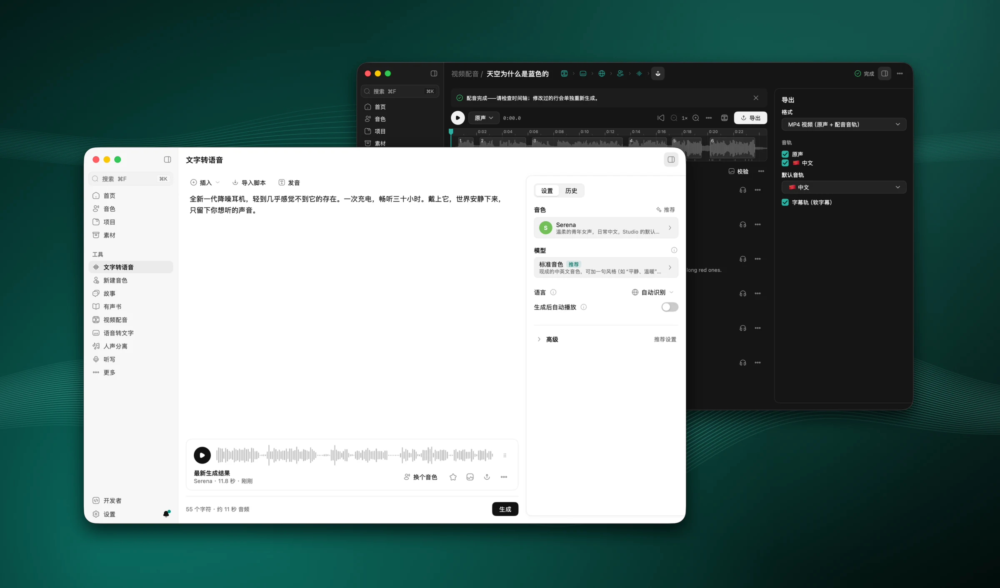
</p>

<h1 align="center">AudioSmith</h1>

<p align="center">
  <b>装在你 Mac 里的录音棚。</b><br>
  语音合成、音色、故事、有声书、视频配音、转写、人声分离和听写，跑在 Apple 芯片上。
</p>

<p align="center">
  <a href="https://actnow.dev/download/audiosmith"></a>
  
  
  <a href="LICENSE"></a>
  <a href="https://awesomemygo.dev/apps/audiosmith"></a>
</p>

<p align="center"><a href="https://actnow.dev/audiosmith">官网</a> · <a href="https://actnow.dev/download/audiosmith">下载</a> · <a href="https://actnow.dev/audiosmith/changelog">更新日志</a></p>

<p align="center"><a href="README.md">English</a> · <b>简体中文</b></p>

AudioSmith 能把文字变成语音，克隆和设计音色，给故事配齐角色，把一本书读成 M4B，把视频配成另一种语言，转写录音并分清谁说了什么，把人声从音乐和噪声里分离出来，还能把你说的话直接打进任何应用。从首页的一个输入框开始，AI Agent 也能通过 MCP 操作这一切。所有模型都用 [MLX](https://github.com/ml-explore/mlx) 在 Mac 的 GPU 上运行：不用注册账号，不用云服务，不用装 Python。本机运行，模型下载后可离线使用。

[功能](#功能) · [安装](#安装) · [模型](#模型) · [隐私](#隐私) · [从源码构建](#从源码构建) · [许可证](#许可证与致谢)

> **当前版本 0.5.0-beta.1 是 Beta 版。** 发布版本用 Developer ID 签名、经过 Apple 公证，并且能自动更新。可能还有不完善的地方，见[已知限制](#已知限制)和[更新日志](https://actnow.dev/audiosmith/changelog)。

## 功能

### 从首页开始

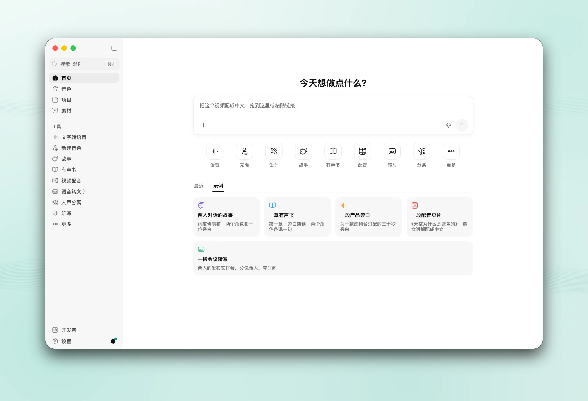

- **一个输入框就能开始。** 输入文字、粘贴链接或拖入文件，按回车：文字会作为脚本打开“文字转语音”，视频或链接直接开始配音，录音会被转写，文本文件或电子书变成有声书。
- **地点和工具分开。** 侧边栏先列出地点——首页、音色库、项目、素材——再列出工具：文字转语音、新建音色、故事、有声书、视频配音、语音转文字、人声分离和听写，工作流、批量配音和电话在“更多”里。每个工具都在页面顶部开始工作，下面列出做好的东西；结果一键交给下一个工具。
- **五个示例**——两人对话的故事、一章有声书、一段产品旁白、一段配音短片、一段会议转写——打开就能播放，并且是你自己的项目，可以随意修改或删除。
- **⌘K 搜索一切**：页面、操作、音色、项目、示例，还能按脚本内容找到生成过的音频。

### 文字转语音

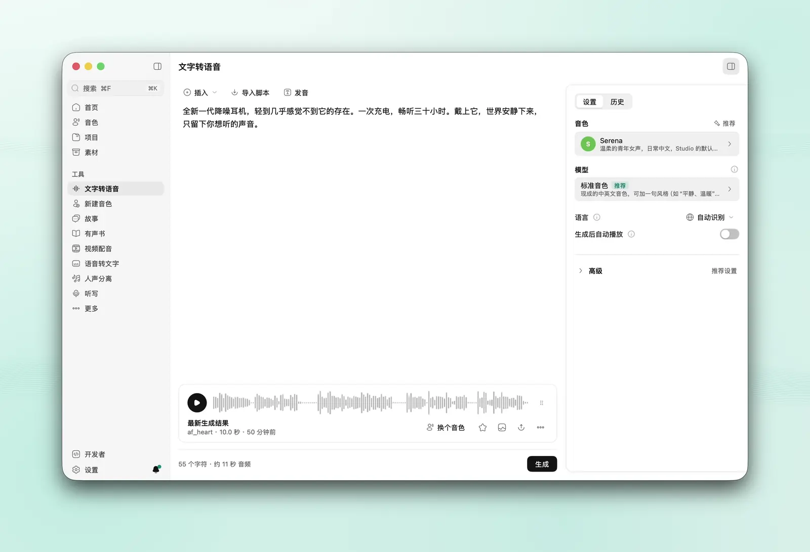

- **写或导入**脚本（TXT、MD、DOCX、EPUB、SRT、VTT），也可以从示例开始。标记可以加停顿（`[pause 400ms]`）、快慢（`[slow]`、`[fast]`）、重音、逐字母拼读和单次读音（`[[词|读法]]`）。
- **按用途选模型**：标准音色、快速克隆、高保真克隆、音色设计、英文极速音色、英文克隆、多语种全能。技术名称点一下就能看到。
- **控件很少**：“设置”面板里只有音色、模型和语速，其余都在“高级”里，填好了针对每个模型实测过的推荐设置。“历史”面板保存这一页生成过的音频：导出、复用设置、换个音色再生成，或存成项目。
- **长文本**分段生成，边生成边播放；没改过的文字直接从缓存取。
- **导出音频**：WAV、M4A；装了 ffmpeg 还能导出 MP3、FLAC、Opus。可把响度统一到 −16、−18 或 −23 LUFS，裁掉首尾静音，写入标签，并在旁边保存脚本和字幕。

### 音色

| 发现 | 我的 |
|---|---|
| 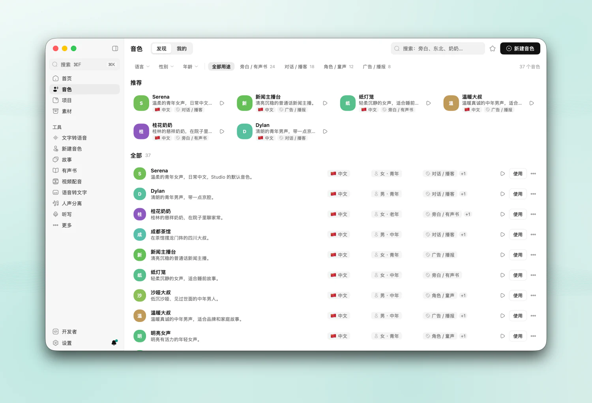 | 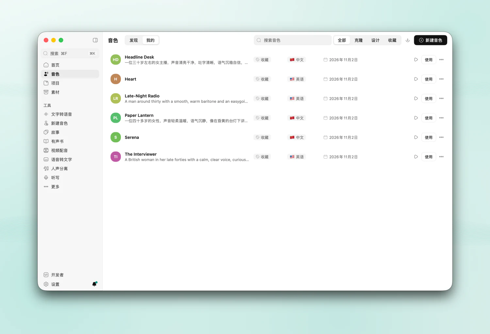 |

- **发现**：37 个精选音色，以中英文为主：自带参考音频、选了就能直接用的设计音色，以及最好的内置说话人。可按语言、性别、年龄和用途筛选；▶ 在行内试听，详情里可以“试一句”“用于文字转语音”“用于故事角色”“用于有声书旁白”“保存到我的音色”。
- **我的**：列出你的音色（克隆、设计、已保存），可以重命名、复制、导出或删除（可撤销）。

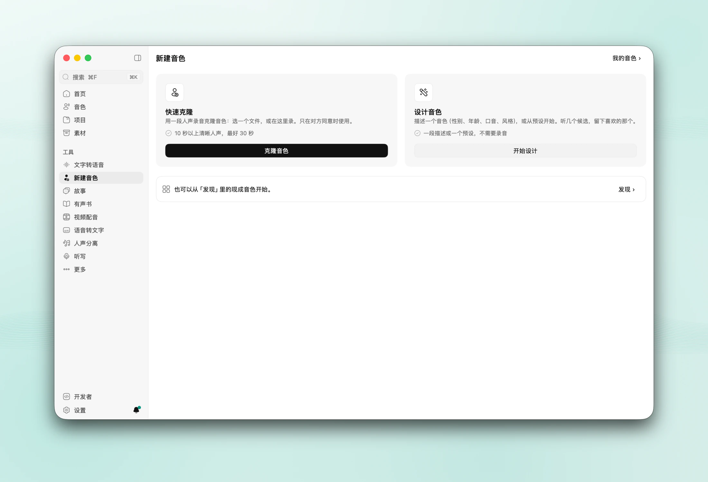

- **新建音色 → 快速克隆**：添加一段录音或任意音视频文件，引导页面会检查它、起名并保存。AudioSmith 会自动挑出最合适的片段并转写；录一段授权声明，可以把音色标记为你本人的声音。
- **参考音频检查**：每段参考都会评级（好、可以、需要改进）并给出一两条建议，同时自动清理：有噪声时才降噪，裁掉首尾静音，统一响度。原始录音会保留。
- **新建音色 → 设计音色**：用一句中文或英文描述（“三十岁左右的温暖女声，语速平稳，像纪录片旁白”），或从预设开始，再从三个候选里挑一个。
- **先听再选**：文字转语音、故事、有声书、视频配音的音色列表里，每个音色都有 ▶ 试听：模型自带的说话人播放内置的短样音（模型还没下载也能听），你自己的音色播放它的样音。
- **可移植副本**：把某个模型的内置说话人或设计出的音色，做成所有克隆模型都能用的克隆音色。听起来接近原声，但不完全一样，界面也会这样说明。
- 音色是可以分享的 `.asvoice` 文件，也能导入 VoiceStudio 的 `.ovsvoice`。

### 故事

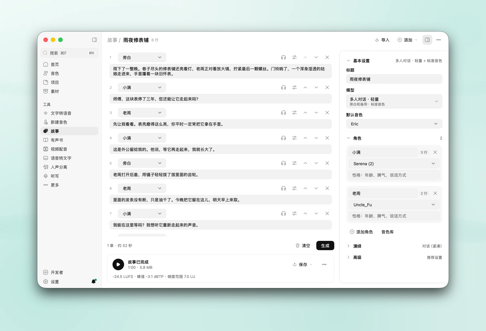

- **从输入框开始**：粘贴剧本，或打开「帮我写」用一句话描述故事；写作助手（在本机运行）会写出一段两三个角色的短场景，然后自动分配音色并打开。
- **按 `名字：台词` 写**，AudioSmith 会自动分配角色。`妈妈（温柔地）：` 这样的舞台提示会变成这句的演绎提示，不会被读出来。
- **对话更连贯**：句间停顿跟着对话走（对话、朗读、舒缓三种节奏）；同一角色连续的几句一口气说完；每个角色的音量自动拉齐。
- **AI 导演**：写作助手（本机的 Qwen3 4B）读完整个故事，给每句定一种情绪（13 种）和强度，整场前后连贯；每一项都可以改。能接收指令的模型会按提示演绎；其他模型照原文朗读，页面上会注明。
- **整场对话**：由对话模型一场一场地说角色的台词，每句都接着上一句回应。*多人对话 · 轻量*（SoulX-Podcast）需要 16 GB 内存，*多人对话 · 一次录成*（MOSS-TTSD）需要 24 GB。旁白仍用故事本身的模型。
- 可导出 WAV、M4B，或每个角色单独一条分轨。

### 有声书

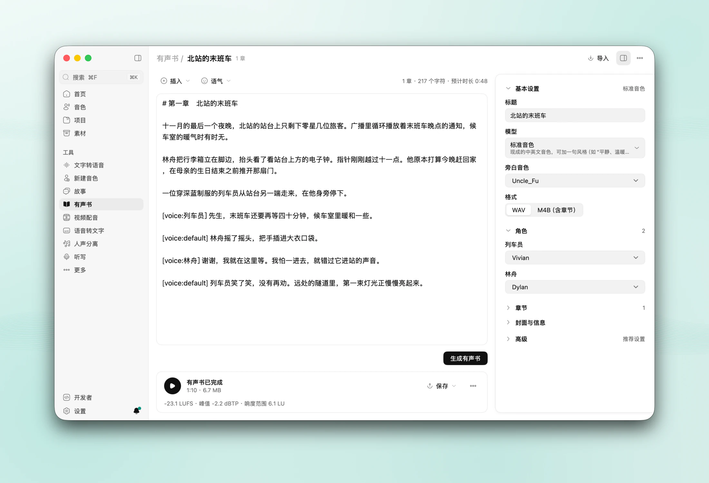

- **粘贴或导入** EPUB、TXT、Markdown 或 DOCX，选好旁白音色，按标题自动分章。
- **多人对话段**：在稿子里用 `[对话]` … `[/对话]`（英文写 `[dialogue]`）标出一场戏，每个回合一行 `名字：台词`，对话模型会让角色互相应答。没有对话模型时逐句朗读。
- **响度**：每章符合 ACX（Audible）或播客标准；跟读播放器会跟着文字走。
- **导出**带章节、封面和标签的 M4B，也可导出章节时间表，或每章一个文件。
- **断点续渲**：退出后可以接着渲染；改动之后只重渲改过的句子。

### 视频配音

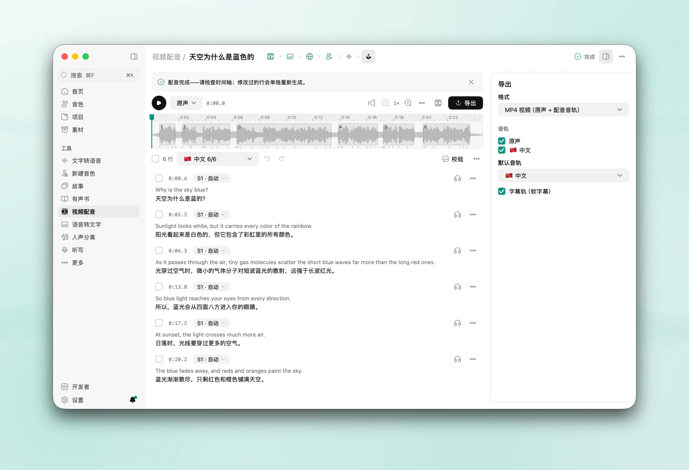

- **拖入视频或音频**，也可以粘贴链接（需要你自己开启 yt-dlp），按“配音”。下载之前页面就会显示封面、网站、标题和时长，下载时显示真实进度。新建配音默认配成中文；如果视频本来就是中文，会自动改成英文。还可以再加其他语言。
- **步骤**——转写、翻译、音色、生成、导出——显示在编辑器的页头，哪步完成、正在进行或出错一目了然：
  1. 分离人声和背景声（HTDemucs），转写并区分说话人（区分说话人转写，或 Qwen3-ASR 加 Sortformer）。
  2. 翻译：本机写作助手、Ollama、云端模型、DeepL、Google 或微软任选，术语表保证名字译得一致。
  3. 用每位说话人的克隆音色逐句配音，并贴合原片时长；跨语言也可以（日语说话人说中文）。这样的句子会再听一遍：语言不对或没念对文本的会重新生成，或标为“请试听”。
- **对话一起录**：配成中文或英文、有两位以上说话人时，*多人对话 · 轻量* 会把每段对话整体录下来，回答听起来像回答，再把每句对齐到原来的时间。新建配音默认开启；需要 16 GB 内存。
- **编辑**：在时间线上改句子（点击跳转，双指捏合或按住 ⌘ 滚动缩放，横向轻扫平移）、A/B 对比、预览视频，只重配改动的部分。2 小时、2,000 句的视频也不卡。
- **导出**：每种语言一条音轨、带软字幕的 MP4，或 M4A、WAV、SRT、VTT、ASS 和分轨。“批量配音”可以处理整个文件夹，也能监控文件夹。

### 语音转文字与听写

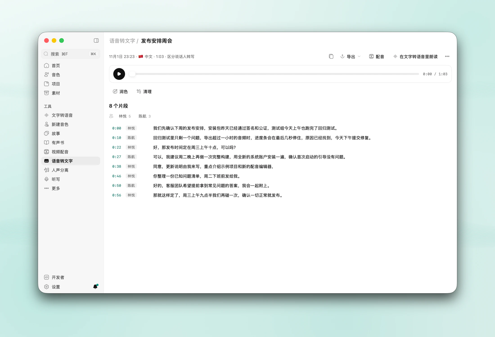

- **转写**录音和视频——拖入、上传、粘贴链接或直接录音——带词级时间，可选“快速”或“精确”。Qwen3-ASR 支持中文、英文等 30 种语言；其他语言用 Whisper，它也能把语音直接译成英文。
- **区分说话人转写**：一次就分清谁说了什么（S1、S2……），点一下就能给说话人起名。拷贝以及 TXT、SRT、VTT、JSON 导出都会带上名字。转写结果一键交给视频配音或文字转语音。
- **全局听写**：在任何应用里按 ⌘⇧Space 说话，文字会打在光标处，说完后约 0.2–0.3 秒出字，并且不会覆盖你的剪贴板。菜单栏图标、一个小浮窗和可自选的提示音会提示正在听。

### 人声分离

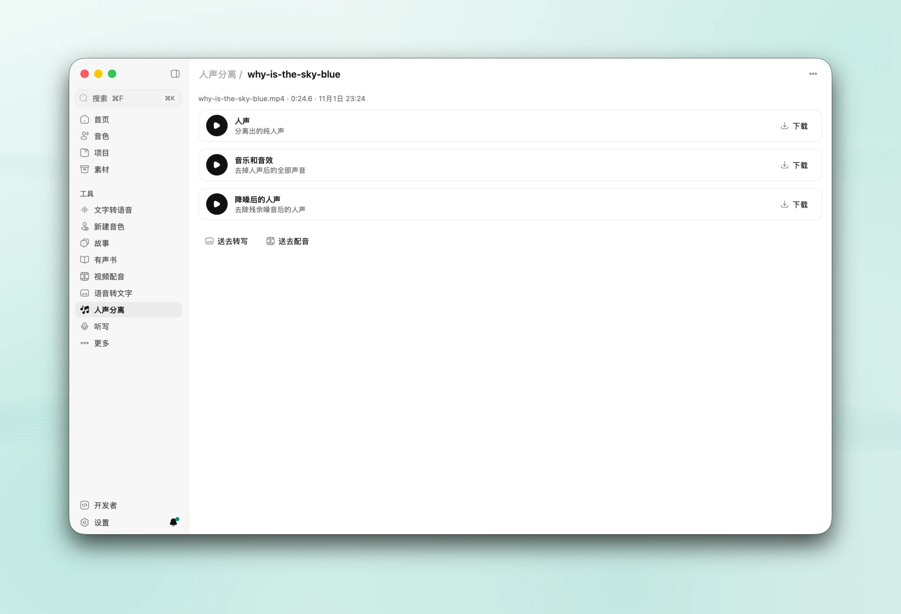

- **拖入歌曲、视频或嘈杂的录音**，在本机分出单独的人声、音乐和音效，以及降噪后的人声（HTDemucs、DeepFilterNet）。
- 每条音轨都能播放、保存，并交给语音转文字或视频配音。

### 项目与素材

| 项目 | 素材 |
|---|---|
| 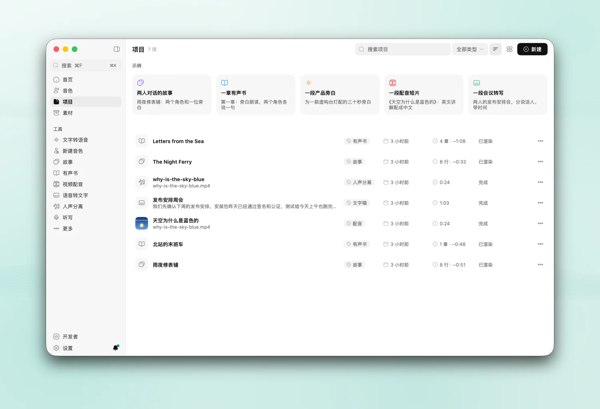 | 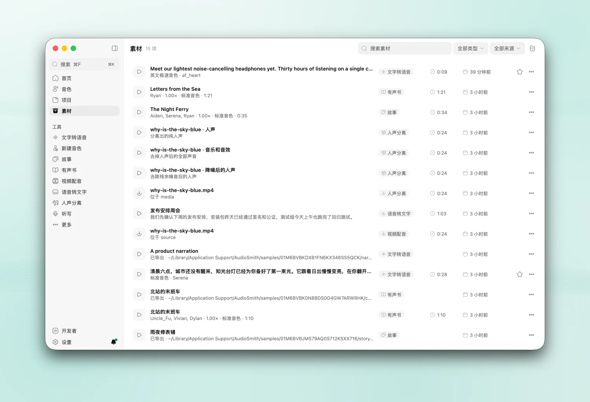 |

- **项目**列出故事、有声书、配音、转写和人声分离，最新的在前；可以搜索标题和脚本内容、按类型筛选，用表格或卡片显示。
- **素材**汇集所有生成的结果和你导入的文件——生成的音频、渲染、导出、分离出的音轨，以及用过的录音和视频。每一行都能直接播放、在对应工具里打开，或交给语音转文字、视频配音、人声分离、文字转语音。
- **工作流**在画布上串起步骤（来源、朗读、转写、翻译、换声、响度、条件、导出），可以从模板开始，一次处理最多 50 个输入；**批量配音**排队处理多个配音，也能监控文件夹。两者重启后都会接着跑。

### 给 Agent 和脚本用

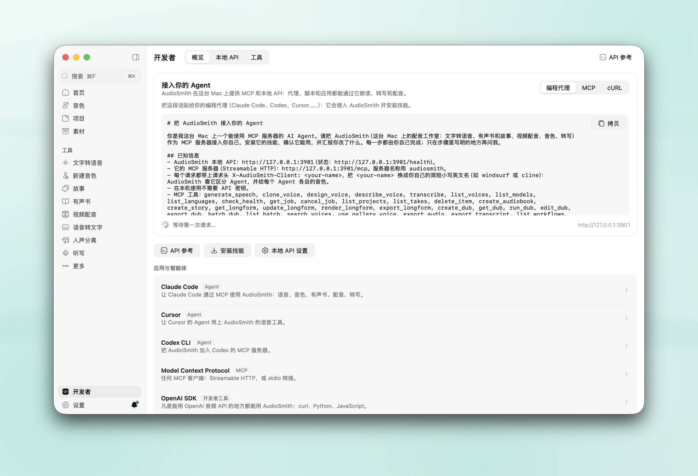

- **开发者 → 接入你的 Agent**：选择编程代理、MCP 或 cURL，复制对应内容——让编程代理自己接入 AudioSmith 并安装技能的提示词、MCP 服务配置，或第一条请求——然后看着“等待第一次请求…”变成最近一次请求的时间。下面列出 Claude Code、Codex、Cursor、n8n 等的接入方法。
- **MCP 服务**：HTTP（`/mcp`）和 stdio（`AudioSmith --mcp-stdio`）两种方式，共 57 个工具：应用能做的，Agent 都能做（听写、电话、麦克风、接受许可和修改设置除外）。已在 ChatGPT（Codex）和 WorkBuddy 上测试。
- **删除或下载前 Agent 会先问你**：说明要删掉什么、要下载多大，等你同意再做。克隆需要确认授权，并且只能在本机（或带 API 密钥）调用。
- **OpenAI 兼容 API**：`http://127.0.0.1:3901/v1`，支持语音合成、转写、翻译、模型和音色，任何 OpenAI SDK 都能直接指过来。**AudioSmith 原生 API**（`/api`）能驱动每个页面；任务进度走 SSE，`/ws/tts` 可以流式合成。

```sh
curl http://127.0.0.1:3901/v1/audio/speech \
  -H 'Content-Type: application/json' \
  -d '{"model": "tts-1", "voice": "alloy", "input": "构建完成，测试全部通过。"}' \
  -o speech.wav
```

完整说明见 [docs/local-api.md](docs/local-api.md)（英文），运行中的应用也在 `/docs` 提供接口参考。

### 还有

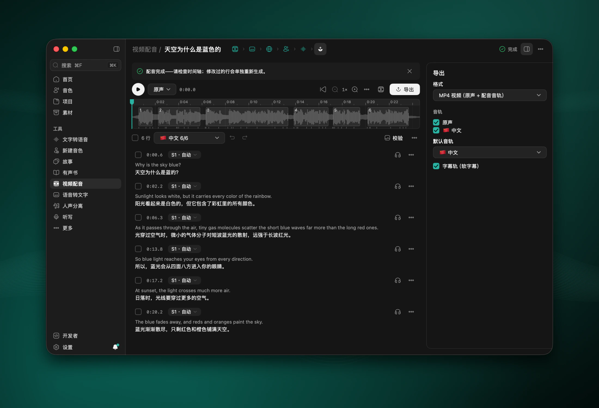

- **工具**（开发者 → 工具）：A/B 对比音色、用另一个音色重说一段录音、按时长改写文字、查看文件信息、检测水印。
- **隐形水印**：生成的音频默认带 AudioSeal 水印（设置 → 隐私），可以在“工具”里检测。
- **电话**：基于你自己 Twilio 账号的 AI 电话代理。它总会说明自己是 AI，只用设计音色或已授权的音色；设置之前不会启用。
- **应用本身**：每个页面有自己的页头和工具；⌘1–8 打开首页、文字转语音、音色库、项目、视频配音、语音转文字、故事和有声书，⌘[ 和 ⌘] 前进后退。“设置”旁的铃铛列出任务和通知；统一的任务队列重启后自动继续。浅色和深色主题，英文和简体中文界面。
- **内存**：30 分钟没用的模型会被卸载（设置 → 模型与网络 → 内存），下次用到时自动重新加载。

## 安装

**要求**
- macOS 15 及以上，Apple 芯片（M1 及以上）。
- 内存：8 GB 可以用“快速”模型包；建议 16 GB，*多人对话 · 轻量* 也需要 16 GB；24 GB 可以用“高质量”模型包（高保真克隆、音色设计、视频配音和写作助手）和 *多人对话 · 一次录成*。
- 磁盘：模型需要 1.3–17 GB，取决于模型包；两个对话模型另需 2.4 GB 和 10.9 GB。

**步骤**
1. 从官网 [actnow.dev/download/audiosmith](https://actnow.dev/download/audiosmith) 下载 DMG。AudioSmith 免费，下载需要一个免费账号；不想注册也可以[从源码构建](#从源码构建)。当前版本是 Beta 版，[更新日志](https://actnow.dev/audiosmith/changelog)列出了所有版本。
2. 把 **AudioSmith** 拖进“应用程序”并打开。正式版本经过签名和公证，Gatekeeper 会放行；macOS 只会询问一次是否打开从网上下载的应用。
3. 设置向导会检查这台 Mac（系统、芯片、内存、磁盘、网络），推荐一个模型包，并询问隐私和听写设置。也可以跳过模型包，之后在“设置 → 模型与网络”里下载。

| 模型包 | 包含 | 下载量 |
|---|---|---|
| **快速** | 内置音色和听写；任何 Mac | 英文界面 1.3 GB，中文界面 2.8 GB |
| **均衡** | 加上克隆、词级时间、降噪；16 GB 内存 | 4.3 / 5.8 GB |
| **高质量** | 加上高保真克隆、音色设计、视频配音、区分说话人、写作助手；24 GB | 13.4 / 14.9 GB |
| **极致** | 加上多语种全能（非商用许可）和 Whisper；48 GB | 15.5 / 17.0 GB |

**更新**：AudioSmith 每天检查一次 actnow.dev 上有没有新版本（不需要账号）。有新版本时，侧边栏底部会显示“有新版本”和更新说明，等你确认后再安装。更新包带签名，安装前会先校验，通常只下载有变化的部分。**AudioSmith → 检查更新…** 可以立即检查；其他选项在 **设置 → 关于 → 软件更新**。

**Beta 版更新**：设置 → 关于 → 软件更新 → **接收 Beta 版更新**。Beta 版（比如 0.5.0-beta.1）里默认打开，正式版里默认关闭，直到你自己选择。关掉之后也不会退回旧版本：Beta 版会一直保留，直到有更新的正式版。

**下载**：从官方站点或镜像中更快的那个下载，并走系统代理：模型来自 huggingface.co 或 hf-mirror.com，ffmpeg 和 yt-dlp 来自 github.com 或 mirror.actnow.dev（ActNow 的镜像），使用前都会校验。国内网络下载慢时，可在 **设置 → 模型与网络 → 下载来源** 选择 **仅镜像**。

**模型**保存在 `~/Library/Application Support/ActNow/models`，与其他 ActNow 应用共用，并且不进 Time Machine 备份（可在“设置 → 高级”重新打开）。

**权限**：只在用到时才请求。**麦克风**用于录制音色、听写和实时转写；**辅助功能**用于听写时把文字打进其他应用。

## 模型

AudioSmith 用“能做什么”来给模型起名。技术名称、大小和许可都在“设置 → 模型与网络”里每个模型的详情中。

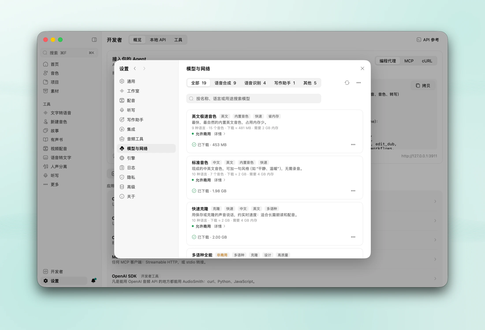

| 应用里的名称 | 模型 | 用途 | 许可 |
|---|---|---|---|
| **标准音色** | Qwen3-TTS 0.6B CustomVoice | 内置中英文说话人，可接收演绎指令 | Apache-2.0 |
| **快速克隆** | Qwen3-TTS 0.6B Base | 快速克隆音色 | Apache-2.0 |
| **高保真克隆** | Qwen3-TTS 1.7B Base | 最还原的克隆 | Apache-2.0 |
| **音色设计** | Qwen3-TTS 1.7B VoiceDesign | 用描述生成音色 | Apache-2.0 |
| **英文极速音色** | Kokoro 82M | 自然的英文内置音色，占用小 | Apache-2.0 |
| **英文克隆** | Chatterbox Turbo | 快速的英文克隆 | MIT |
| **多语种全能** | OmniVoice | 600 多种语言，克隆、设计、精确时长 | **CC BY-NC 4.0：禁止商用**，使用前需确认许可 |
| **中英文转写** | Qwen3-ASR 0.6B | 转写和听写，30 种语言 | Apache-2.0 |
| **多语种转写** | Whisper large-v3 turbo | 其他语言；语音译成英文 | MIT |
| **区分说话人转写** | MOSS-Transcribe-Diarize 0.9B | 一次分清谁说了什么 | Apache-2.0 |
| **多人对话 · 轻量** | SoulX-Podcast 1.7B | 对话一起录，最多 4 人；2.4 GB，需 16 GB 内存 | Apache-2.0 |
| **多人对话 · 一次录成** | MOSS-TTSD v1.0 | 一场戏一次录成，最多 5 人；10.9 GB，需 24 GB 内存 | Apache-2.0 |
| **写作助手** | Qwen3 4B Instruct 2507 | 翻译、文字清理、AI 导演 | Apache-2.0 |
| 逐词对齐 · 语音检测 · 语音降噪 | Qwen3-ForcedAligner 0.6B · Silero VAD · DeepFilterNet 3 | | Apache-2.0 · MIT · MIT/Apache-2.0 |
| 快速人声分离 · 说话人区分 | HTDemucs · Sortformer（备用，最多 4 人） | | MIT · NVIDIA Open Model License |
| 隐形水印 | AudioSeal | | MIT |

在 MacBook Air M4（24 GB）上实测：

| 项目 | 结果 |
|---|---|
| 听写（Qwen3-ASR） | 说完后 0.2–0.3 秒出字 |
| 高保真克隆 | 约等于实时：940 个汉字，3.5 分钟音频，约 3¼ 分钟生成 |
| 标准音色 | 约 1.7 倍实时 |
| 区分说话人转写 | 10 分钟录音约 4 分钟 |
| 多人对话 · 轻量 / 一次录成 | 约 0.7 / 0.8 倍实时 |
| 写作助手 | 每秒 36–40 个 token |

## 隐私

- **语音在你的 Mac 上合成和识别。** 引擎本身从不联网，只加载应用下载好的模型。
- **AudioSmith 只在这些时候联网**：下载模型（Hugging Face 或其镜像）；你下载 ffmpeg 和 yt-dlp 时；下载你粘贴的视频链接（及其封面）；你主动设置了云端写作或翻译服务时；每天一次的更新检查（不会发送任何关于你的信息）。
- **没有统计**：不收集使用数据、崩溃报告或任何标识，也没有能打开它们的设置。应用日志只留在本机，会遮住密钥和令牌，从不记录你的脚本、转写或提示词。
- **本地 API 只监听 127.0.0.1**，除非你主动在局域网共享（需要 PIN 码）。
- **文字只留在这台 Mac**：一个开关就能让写作助手和翻译只用本地模型。
- 你的资料库在 `~/Library/Application Support/AudioSmith`（可以移到其他磁盘），密钥保存在登录钥匙串里。

## 从源码构建

需要 Xcode 26（Swift 6.2 及以上）和 Go 1.27.3（`GOTOOLCHAIN=auto` 会自动下载）。

```sh
scripts/fetch-engine-deps.sh    # 上游 mlx-audio-swift + AudioSmith 的补丁
scripts/build-engine.sh         # Swift 引擎（xcodebuild；首次约 4 分钟）
go tool mygo dev                # 热重载运行
go tool mygo build              # 生成 build/darwin-arm64/AudioSmith.app 和 DMG
```

- 界面用 Go 和 [MyGo](https://github.com/egoist/mygo) 编写，代码在 `app/`（`go run ./app` 不打包直接运行），它嵌入的文件在 `assets/`；模型在 Swift 辅助进程 `audiosmith-engine` 里运行，基于 [mlx-audio-swift](https://github.com/Blaizzy/mlx-audio-swift) 和 mlx-swift。
- `CGO_ENABLED=0 go test ./...` 可以在任何系统上无界面地跑完整个 UI 的测试（引擎用假实现）；`scripts/mac.sh` 可以从 Linux 在 Mac 上构建和测试。
- 更多（英文）：[架构](docs/architecture.md)、[引擎协议](docs/protocol-v2.md)、[本地 API 与 MCP](docs/local-api.md)、[发布流程](docs/release.zh-CN.md)。

## 已知限制

- **Beta 版**：0.5.0 还没定稿，各个 Beta 之间可能有变化。
- **ffmpeg 可选，不内置。** 没有它也能读写 WAV、AIFF、M4A、MOV、MP4，并读取 MP3；装了它（Homebrew 版，或你自己指定的）还能导出 MP3、Opus、FLAC，读取 WebM、MKV，并给视频烧录字幕。
- **听写**要说完才出文字，不能边说边出。长时间没用后的第一次听写，要先加载模型，可能多等一秒左右。
- **对话模型**只在中文和英文上评测过，其他语言逐句朗读。配音里的对话只用 *多人对话 · 轻量*；*多人对话 · 一次录成* 需要 24 GB 内存。
- **需要登录的链接**（比如 X、抖音）要提供从浏览器导出的 cookies.txt。
- **界面语言**只有英文和简体中文。
- **水印**在时间拉伸超过约 ±5% 时会失效，所以配音的水印在贴合时长之后再加。
- **电话**需要你自己的 Twilio 账号和一个公网隧道。
- 自己构建的版本是 ad-hoc 签名：不会自动更新，每次重新构建后 macOS 会忘掉它的辅助功能授权，听写提示音用系统声音（ActNow 音效库只随发布版本提供）。

## 参与贡献

欢迎报告问题、提建议和提交 PR：要运行的检查见 [CONTRIBUTING.md](CONTRIBUTING.md)。你的第一个 PR 合并之前，需要在 PR 里留言签署[贡献者许可协议（CLA）](CLA.md)，机器人会提示你。

## 许可证与致谢

Copyright (C) 2026 hehehai and the AudioSmith contributors.

AudioSmith 是自由软件：你可以按自由软件基金会发布的 [GNU Affero 通用公共许可证](LICENSE)第 3 版（AGPL-3.0）再分发和修改它。我们希望它有用，但不提供任何担保，详见许可证。如果你把修改过的 AudioSmith 通过网络提供给别人使用（比如它的本地 API），AGPL 要求你向这些用户提供你那个版本的源代码。0.4.0-beta.1 及更早的版本以 Apache License 2.0 发布，仍适用该许可。

模型权重各有自己的许可（见[模型](#模型)），其中 OmniVoice 禁止商用。第三方素材和库列在 [NOTICE](NOTICE) 里，完整的许可文本见 [THIRD-PARTY-NOTICES.txt](THIRD-PARTY-NOTICES.txt)（应用里都带有这两个文件）。

- 模型来自 Qwen 团队（Qwen3-TTS、Qwen3-ASR、Qwen3 4B）、hexgrad（Kokoro）、Resemble AI（Chatterbox）、k2-fsa（OmniVoice）、Soul AI Lab（SoulX-Podcast）、OpenMOSS（MOSS-TTSD、MOSS-Transcribe-Diarize）、OpenAI（Whisper）、Meta（HTDemucs、AudioSeal）、NVIDIA（Sortformer）、Silero 和 DeepFilterNet；MLX 版本由 mlx-community 等转换。
- 运行在 [MLX](https://github.com/ml-explore/mlx)、[mlx-swift](https://github.com/ml-explore/mlx-swift) 和 [mlx-audio-swift](https://github.com/Blaizzy/mlx-audio-swift) 之上。
- 界面基于 [MyGo](https://github.com/egoist/mygo)（MIT）。
- 图标：480 Design 的 [Solar](https://icon-sets.iconify.design/solar/)，CC BY 4.0 许可；播放和暂停图标：[Hugeicons](https://icon-sets.iconify.design/hugeicons/)，MIT 许可（见 [NOTICE](NOTICE)）。
